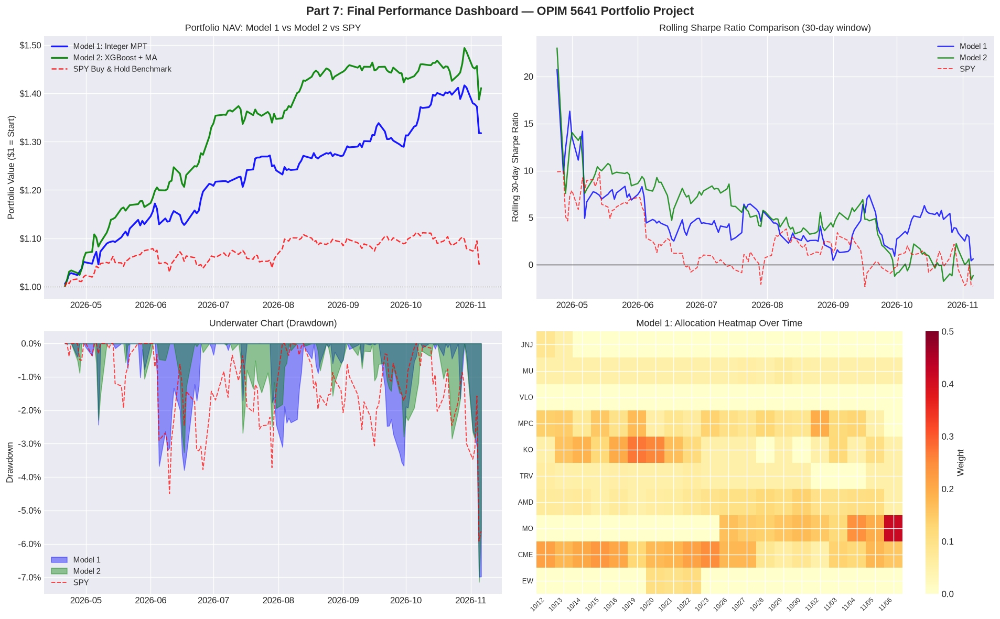

# Latest Portfolio Summary

Latest refresh date: **2026-11-06**

| Metric | Value |
|---|---:|
| Portfolio value | $131,758.16 |
| Wealth gain | $31,758.16 |
| Cumulative return | 31.01% |
| Average daily return | 0.20% |
| Holdings | 10 |
| Sector rule | 2 stocks from each of 5 sectors |
| Weight bounds | 5% minimum, 50% maximum |

## Latest Holdings

| Stock | Sector | Weight | Holding Value |
| --- | --- | --- | --- |
| MO | ConsumerStaples | 41.74% | $54,998.01 |
| CME | Financials | 15.34% | $20,209.59 |
| ABBV | Healthcare | 7.92% | $10,435.20 |
| AMD | Technology | 5.00% | $6,587.91 |
| PSX | Energy | 5.00% | $6,587.91 |
| APA | Energy | 5.00% | $6,587.91 |
| MU | Technology | 5.00% | $6,587.91 |
| TRV | Financials | 5.00% | $6,587.91 |
| KO | ConsumerStaples | 5.00% | $6,587.91 |
| LLY | Healthcare | 5.00% | $6,587.91 |

## Dashboard

