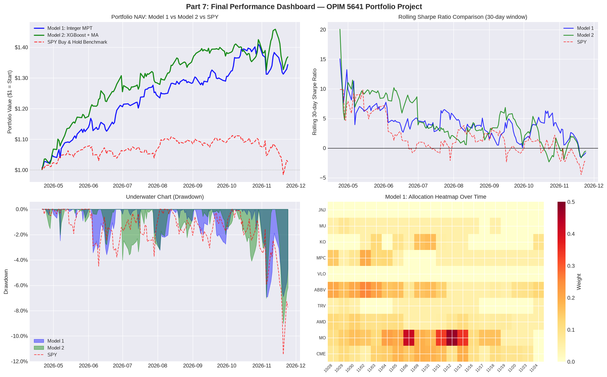

# Latest Portfolio Summary

Latest refresh date: **2026-11-16**

| Metric | Value |
|---|---:|
| Portfolio value | $135,619.47 |
| Wealth gain | $35,619.47 |
| Cumulative return | 34.86% |
| Average daily return | 0.21% |
| Holdings | 10 |
| Sector rule | 2 stocks from each of 5 sectors |
| Weight bounds | 5% minimum, 50% maximum |

## Latest Holdings

| Stock | Sector | Weight | Holding Value |
| --- | --- | --- | --- |
| WMT | ConsumerStaples | 28.91% | $39,213.78 |
| MO | ConsumerStaples | 17.74% | $24,052.62 |
| CME | Financials | 14.68% | $19,911.06 |
| AMD | Technology | 6.50% | $8,808.81 |
| TRV | Financials | 6.19% | $8,389.14 |
| ABBV | Healthcare | 5.99% | $8,120.16 |
| MU | Technology | 5.00% | $6,780.97 |
| MPC | Energy | 5.00% | $6,780.97 |
| PSX | Energy | 5.00% | $6,780.97 |
| LLY | Healthcare | 5.00% | $6,780.97 |

## Dashboard

