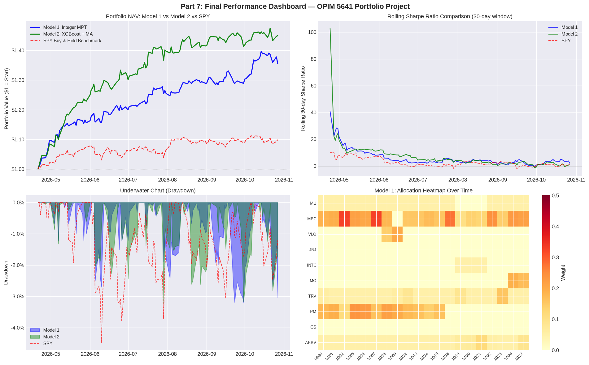

# Latest Portfolio Summary

Latest refresh date: **2026-10-19**

| Metric | Value |
|---|---:|
| Portfolio value | $142,091.09 |
| Wealth gain | $42,091.09 |
| Cumulative return | 41.84% |
| Average daily return | 0.28% |
| Holdings | 10 |
| Sector rule | 2 stocks from each of 5 sectors |
| Weight bounds | 5% minimum, 50% maximum |

## Latest Holdings

| Stock | Sector | Weight | Holding Value |
| --- | --- | --- | --- |
| KO | ConsumerStaples | 22.96% | $32,624.64 |
| ABBV | Healthcare | 14.86% | $21,109.80 |
| PSX | Energy | 14.67% | $20,837.70 |
| MPC | Energy | 10.50% | $14,922.00 |
| GOOGL | Technology | 9.60% | $13,636.26 |
| INTC | Technology | 6.86% | $9,745.23 |
| TRV | Financials | 5.56% | $7,901.79 |
| MRK | Healthcare | 5.00% | $7,104.55 |
| JPM | Financials | 5.00% | $7,104.55 |
| WMT | ConsumerStaples | 5.00% | $7,104.55 |

## Dashboard

